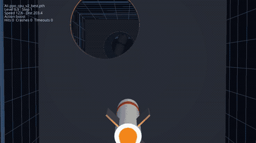
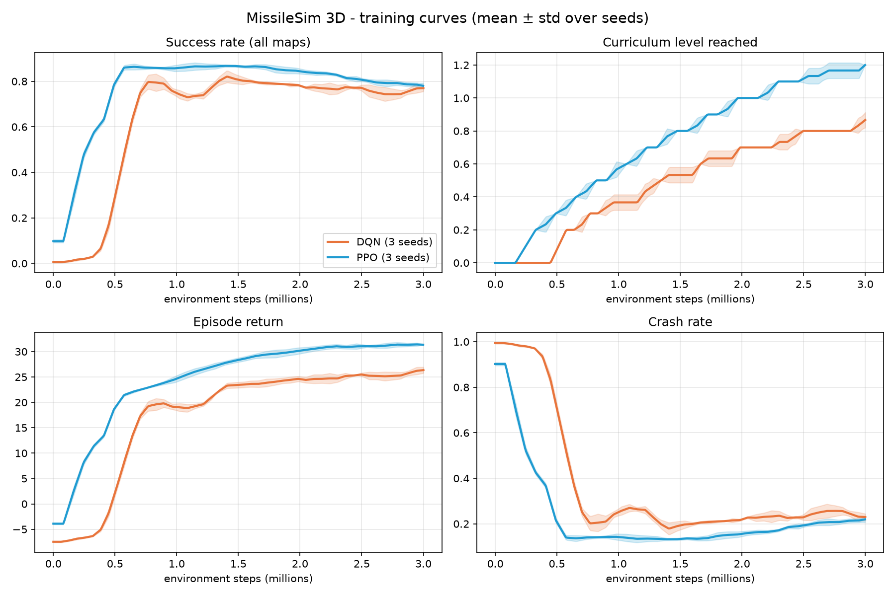
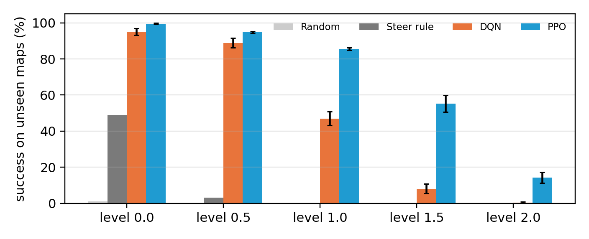

# MissileSim 3D — Reinforcement Learning for Autonomous Missile Navigation

**Team:** Darsh Choudhary (B24CM1019), Vinamra Gupta (B24CM1068)  
**Report:** [`docs/report.pdf`](docs/report.pdf)

An RL agent learns to fly a missile through **procedurally generated 3D tunnels** full of
static pipes, **moving pipes** and **gates** (walls with one hole), and hit a target core at the
end — using only onboard range sensors. Every episode is a brand-new map, and all results are
measured on **held-out maps never seen during training**. Two algorithms are implemented from
scratch in PyTorch and compared: **PPO** (main) and **DQN** (baseline).



## Results

Success rate on 300 unseen maps per difficulty level (mean ± std over 3 seeds, 3M training steps each):

| Policy | level 0.0 | level 0.5 | level 1.0 | level 1.5 | level 2.0 |
|---|---|---|---|---|---|
| Random | 1.0 | 0.0 | 0.0 | 0.0 | 0.0 |
| Steer-to-target rule (baseline) | 49.0 | 3.3 | 0.0 | 0.0 | 0.0 |
| DQN | 95.1 ± 1.9 | 88.9 ± 2.6 | 47.0 ± 3.8 | 8.1 ± 2.7 | 0.4 ± 0.5 |
| **PPO** | **99.5 ± 0.4** | **94.8 ± 0.4** | **85.5 ± 0.7** | **55.3 ± 4.6** | **14.2 ± 3.0** |

PPO beats DQN at every level, and the gap grows as maps get harder. Both learn obstacle avoidance
that the hand-coded rule cannot do.




## The RL formulation (summary — details in the report)

| | |
|---|---|
| **State** (61, continuous) | 5×5 ray-cast depth grid ahead of the nose at *t* and *t−1* (50), target direction in the missile's frame (3), distance (1), speed (1), pitch (1), sin/cos heading (2), position in tunnel cross-section (2), remaining length (1) |
| **Actions** (7, discrete) | coast, pitch up, pitch down, yaw left, yaw right, boost, brake |
| **Reward** | `0.1·(distance closed) − 0.01 per step + 20 hit − 10 crash − 5 timeout` |
| **Episode ends** | target hit, crash (wall / pipe / gate), or time limit |
| **Curriculum** | difficulty `level ∈ [0, 2]`; +0.1 when success ≥ 75% at the current level. Level 1–2 is an *expert tier* (400-long tunnels, ~13 moving pipes, ~8 gates) |

## Installation

Python 3.10+ on Linux / macOS / Windows. No GPU needed.

```bash
git clone https://github.com/Vinamra3215/Missile-Sim.git
cd Missile-Sim
python3 -m venv ~/msim-venv
source ~/msim-venv/bin/activate              # Windows: %USERPROFILE%\msim-venv\Scripts\activate
pip install torch --index-url https://download.pytorch.org/whl/cpu
pip install -r requirements.txt
python tests/test_env.py                     # should print 5 x PASS
```

Dependencies: `torch`, `numpy`, `pandas`, `matplotlib`, `ursina` (3D viewer only).

## Usage

**Watch the trained agent / play yourself (3D viewer):**
```bash
python viewer.py --policy pretrained/ppo.pth --level 0.5
python viewer.py --policy pretrained/dqn.pth --level 0.5
python viewer.py --policy steer                # hand-coded baseline
```
`TAB` switch AI ↔ manual · arrows pitch/yaw · `SHIFT` boost · `CTRL` brake · `C` camera ·
`R` new map · `+`/`-` difficulty · `[`/`]` playback speed · `SPACE` pause · `ESC` quit.
Record a video: `python viewer.py --policy pretrained/ppo.pth --record 20 --out demo/ppo.mp4` (needs ffmpeg).

**Train:**
```bash
python train_ppo.py --seed 1                   # ~11 min on a desktop CPU
python train_dqn.py --seed 1                   # ~16 min
python train_ppo.py --total-steps 200000       # quick smoke test
```
Outputs: `models/<run>_best.pth`, `results/<run>/progress.csv`.

**Evaluate on held-out maps:**
```bash
python evaluate.py --policies random steer pretrained/ppo.pth pretrained/dqn.pth
```

## Reproducing the results

```bash
PARALLEL=1 SEEDS="1 2 3" bash scripts/run_cpu.sh    # 6 runs in parallel, ~20 min on an 8-thread CPU
cat logs/eval.log                                  # results table
ls plots/                                          # training_curves.png, evaluation.png, ...
```
Without `PARALLEL=1` the runs execute one after another (~1.5 h). Exact numbers vary slightly
between machines (floating-point non-determinism), which is why we report mean ± std over seeds.

## Project structure

```
sim3d/config.py        all environment parameters (world, missile, sensors, rewards, curriculum)
sim3d/tunnel_env.py    batched 3D environment: map generation, physics, collisions, ray casting
agents/networks.py     neural networks: dueling Q-network (DQN), actor-critic (PPO)
agents/ppo.py          PPO: GAE, clipped surrogate objective, LR annealing
agents/dqn.py          DQN: double DQN, dueling head, n-step returns, replay buffer
agents/common.py       curriculum, logging
agents/policy.py       load trained agents and baselines
train_ppo.py           PPO training script
train_dqn.py           DQN training script
evaluate.py            held-out evaluation
plot_results.py        training curves and evaluation plots
viewer.py              3D viewer, manual play, video recording (Ursina)
tests/test_env.py      environment sanity tests
scripts/run_cpu.sh     full experiment (training, evaluation, plots)
pretrained/            trained PPO and DQN agents
docs/                  report (PDF + LaTeX source), figures, demo
```

## Development history

The project started as a 2D prototype (point-mass missile, fixed obstacles, Pygame renderer).
We replaced it with the 3D simulator because the 2D agent could not perceive obstacles and a
fixed level invites memorisation; procedural maps with held-out evaluation test real
generalisation.

## References

Mnih et al. 2015 (DQN) · Schulman et al. 2017 (PPO) · Schulman et al. 2016 (GAE) ·
van Hasselt et al. 2016 (Double DQN) · Wang et al. 2016 (Dueling DQN) ·
Bengio et al. 2009 (Curriculum learning) · Cobbe et al. 2019 (Generalisation in RL).
Full citations in the report.
